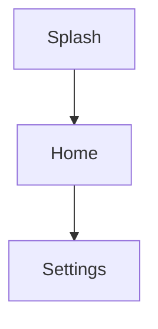
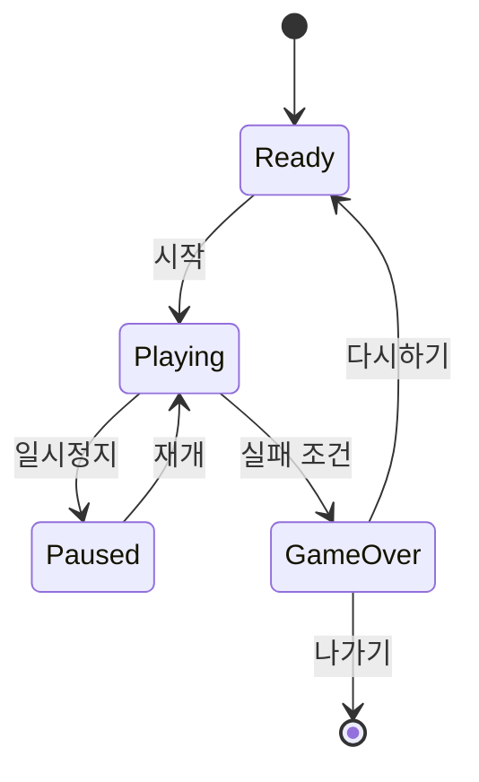

# 화면 흐름도 (Screen Flow)

> 앱마다 이 문서를 복사해 `docs/screen-flow/<app_name>.md`로 작성한다.
> 다이어그램은 Mermaid로 작성한다 — 코드 리뷰가 가능하고, GitHub/IDE에서 바로 렌더링된다.

- **대상 앱**: `apps/<app_name>`
- **기준 PRD**: `docs/prd/<app_name>.md`
- **문서 상태**: 초안 / 확정

---

## 1. 화면 목록

> 화면 ID는 라우트 이름과 1:1로 대응시킨다 (go_router의 `name`과 동일하게).

| 화면 ID | 이름 | 목적 (1문장) | 진입 조건 |
|---------|------|--------------|-----------|
| `home`  |      |              |           |
|         |      |              |           |

## 2. 전체 흐름도

**작성 규칙**

- 노드 = 화면(라우트), 간선 = 사용자 액션. 간선 라벨에 액션을 적는다 (`-->|버튼 탭|`).
- 다이얼로그/바텀시트는 별도 노드로 그리지 않고 필요 시 점선(`-.->`)으로 표기한다.
- 게임 앱의 경우 **게임 내부 상태(플레이 중, 일시정지, 게임오버)는 화면 흐름도가 아니라 아래 3절의 상태 다이어그램**으로 그린다. 화면 흐름도에서 게임은 `GameScreen` 노드 하나다.

## 3. (게임 앱 전용) 인게임 상태 다이어그램

## 4. 딥링크 / 진입점

| 진입점 | 도착 화면 | 비고 |
|--------|-----------|------|
| 앱 아이콘 | `splash` → `home` | |
| 푸시 알림 |  | 해당 시 |

## 5. 화면별 메모

> 흐름도로 표현 안 되는 것만: 뒤로가기 처리, 상태 유지 여부, 전환 애니메이션 특이사항 등.

- `home`:
