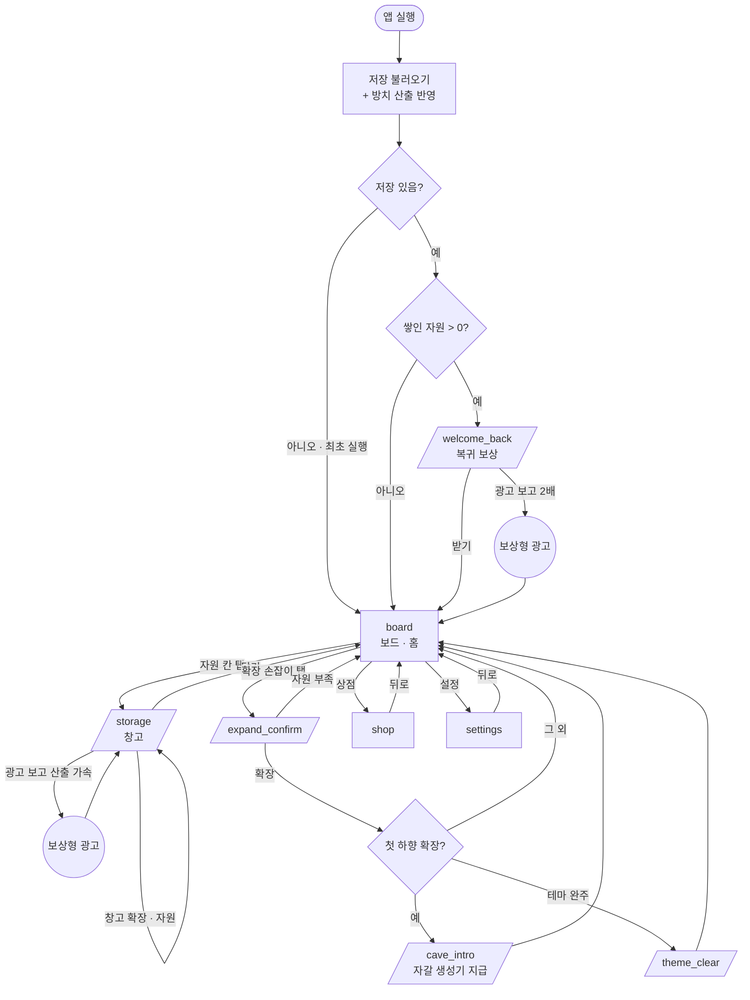
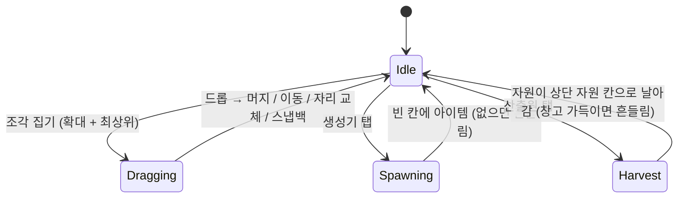

# 화면 흐름도 — deep_grove (Deep Grove)

- **대상 앱**: `apps/deep_grove`
- **기준 PRD**: `docs/prd/deep_grove.md` · 게임 규칙: `docs/design/deep_grove-themes.md`
- **문서 상태**: 초안 (2026-11-05)

---

## 1. 화면 목록

화면 ID는 go_router의 `name`과 1:1로 대응시킨다. **화면은 3개뿐이고, 나머지는 보드 위에
뜨는 시트·팝업이다.** 머지 게임은 보드를 떠나지 않는 것이 기본이라, 보드를 가리는 전환을
최소로 둔다.

| 화면 ID | 이름 | 목적 (1문장) | 진입 조건 |
|---------|------|--------------|-----------|
| `board` | 보드 (홈) | 머지·스폰·산출 회수·확장을 한 화면에서 한다 | 기본 진입 화면. 홈 화면을 따로 두지 않는다 |
| `shop` | 상점 | 비소모성 IAP 2종(창고 확장팩·영구 산출 가속)을 사고 복원한다 | `board` 상단 상점 버튼 |
| `settings` | 설정 | 진동, 구매 복원, 개인정보처리방침, 버전 | `board` 상단 설정 버튼 |

보드 위 시트·팝업 (화면이 아니다 — 라우트를 만들지 않고 `board` 안에서 띄운다):

| ID | 이름 | 뜨는 때 |
|----|------|---------|
| `welcome_back` | 복귀 보상 | 앱을 다시 열었을 때 방치 산출로 쌓인 자원이 있으면 |
| `storage` | 창고 | 상단 자원 칸 탭 |
| `expand_confirm` | 확장 확인 | 보드 가장자리 확장 손잡이 탭 |
| `cave_intro` | 동굴 진입 | 첫 하향 확장 직후 1회 |
| `theme_clear` | 테마 완주 | 테마 완주 확장을 산 직후 1회 |

## 2. 전체 흐름도

**작성 규칙 적용 메모**

- 둥근 칸 `(( ))`은 보상형 광고 재생이다. 광고가 실패·취소되면 보상 없이 원래 자리로 돌아간다
  (`welcome_back`은 1배로 받기, `storage`는 그대로).
- 최초 실행은 `welcome_back` 없이 바로 시작 보드(숲 3×4, 씨앗 생성기 + 씨앗 2개)로 간다.

## 3. (게임 앱 전용) 인게임 상태 다이어그램

### 3.1 조각 조작 — 프로토타입 그대로

드롭 판정 4종은 `docs/prd/proto_merge.md` §4 표 그대로다. 산출원(체인 최고 레벨 조각)은
아이템처럼 드래그로 옮기고 자리 교체되지만, 머지는 되지 않는다(최고 레벨).

### 3.2 확장 손잡이 상태

보드 오른쪽 가장자리(가로 = 숲)와 아래 가장자리(아래 = 동굴)에 손잡이가 하나씩 붙는다.

| 상태 | 표시 | 탭 |
|------|------|----|
| 확장 가능 | 비용 표시 + 강조 | `expand_confirm` |
| 자원 부족 | 비용 표시, 모자란 자원만 흐리게 | `expand_confirm` (확장 버튼 비활성, 모자란 양 표시) |
| 이 방향 끝 | 손잡이 없음 | — |

동굴 진입 전 아래 손잡이는 "동굴 진입" 라벨로 따로 보인다 — 첫 하향 확장이 특별한 단계임을
미리 알린다 (테마 문서 §3).

## 4. 딥링크 / 진입점

| 진입점 | 도착 화면 | 비고 |
|--------|-----------|------|
| 앱 아이콘 | `board` (쌓인 자원이 있으면 `welcome_back` 먼저) | |
| 푸시 알림 | 없음 | v1 비범위 (PRD §4) |

## 5. 화면별 메모

흐름도로 표현되지 않는 것만 적는다.

### `board` (홈)

- **배치 (세로, 위에서 아래)**: 상단 바(자원 칸 목재·광석 · 상점 · 설정) / 보드 / 아래 여백.
  광석 칸은 동굴 진입 전에는 숨긴다 — 아직 없는 자원을 보여 주지 않는다.
- **자원 칸**: 현재량/용량과 가득 참 표시. 가득 차면 방치 산출이 멈춘다는 걸 여기서 보여 준다
  (PRD §2 접속 주기의 근거).
- **보드**: 숲 위, 동굴 아래로 붙는다. 지대 경계에 선을 둔다. 셀 크기는 화면 폭과 남은 높이
  중 작은 쪽에 맞춘다 — 최대 크기(6열 × 숲 4 + 동굴 3 = 7행, 테마 문서 §5)에서도 스크롤 없이 한 화면에 든다.
  확장하면 셀이 작아질 수 있다 — 스크롤·확대는 두지 않는다 (조작이 드래그드롭과 겹친다).
- **지대 보너스 표시**: 맞는 지대에 있는 산출원에 작은 표시. 드래그 중에는 맞는 지대 칸을
  옅게 밝혀 "여기 두면 더 낸다"를 보여 준다.
- **첫 실행 안내**: 튜토리얼 화면 없이 손가락 표시 두 번만 — 생성기 탭, 첫 확장 손잡이
  (첫 확장 가능 시점에). PRD §4.
- 상태 유지: 보드는 매 조작마다 저장한다(조각 수십 개, JSON 스냅샷). 앱이 언제 죽어도 마지막
  조작까지 남는다.

### `welcome_back` (복귀 보상)

- 자원별 쌓인 양을 보여 주고 [받기] [광고 보고 2배]. 받기 전까지 창고에 들어가지 않는다.
- 2배를 받아도 창고 용량을 넘지 않는다 — 넘친 만큼은 버려진다는 것을 숫자로 보여 준다
  (용량이 판단 근거가 되어야 창고 확장이 목표가 된다). 광고 버튼에는 **실제로 더 들어오는 양**
  (+N)을 적고, 그게 0이면("창고가 가득 차서 더 받을 수 없어요") 또는 오늘 상한에 닿았으면
  ("오늘 광고를 다 봤어요") 버튼을 막는다 — 보상 없는 광고를 보게 하지 않는다.
- 쌓인 양이 0이면 띄우지 않는다. 짧은 재접속(예: 1분)은 쌓인 양이 작아도 띄울지는
  경제 수치와 함께 정한다 (PRD §10-3).

### `storage` (창고)

- 자원별 현재량/용량, 산출원 수와 시간당 산출량(지대 보너스 포함).
- [창고 확장] — 자원으로 용량을 올린다(진행 목표). 비용은 테마 데이터.
- [광고 보고 산출 가속] — 남은 가속 시간과 오늘 남은 횟수 표시. 상한에 닿으면 비활성.
  가속 중이면 버튼이 "연장"이 되고, 분당 산출량 표시에 배율이 반영된다.
- 가속 중에는 `board` 상단 바에 번개 칩("2배 N분")이 뜨고, 누르면 이 시트가 열린다.
- 상점의 창고 확장팩을 샀으면 용량 옆에 표시. 미구매면 상점으로 가는 작은 링크.

### `expand_confirm` (확장 확인)

- 방향(숲 넓히기 / 동굴 파기), 늘어나는 칸 수, 비용, 보유량. 한 번 더 누르면 확장.
- 확장 직후 새 행/열이 열리는 연출 — 새 칸이 비어 있다는 게 곧 보상이다.

### `cave_intro` · `theme_clear`

- `cave_intro`: 자갈 생성기를 새 동굴 칸 하나에 놓아 주며 한 줄 설명. 1회.
- `theme_clear`: 첫 테마 완주 축하 + "다음 테마 준비 중" (PRD §3). 이후 보드는 계속 쓸 수 있다.

### `shop`

- 상품 2개(창고 확장팩 · 영구 산출 가속) + 구매 복원. 버튼에는 스토어 가격, 산 상품은 "구매함".
- 결제 실패·취소는 화면을 떠나지 않고 짧은 안내(스낵바)만. 결제 창이 떠 있는 동안 버튼을 막는다.
- 맨 아래 한 줄: "보드 확장은 상품으로 살 수 없어요" (PRD §6 원칙).
- 창고 시트에서 창고 확장팩이 없으면 상점으로 가는 링크가 보인다.

### 뒤로가기 (Android)

- 시트·팝업이 떠 있으면 닫는다. `welcome_back`을 뒤로가기로 닫으면 **1배로 받는다** — 쌓인
  자원을 잃지 않는다.
- `shop`·`settings`에서는 `board`로.
- `board`에서는 시스템 기본(앱 나가기). 저장은 이미 끝나 있으므로 확인 다이얼로그를 두지 않는다.

## 6. 분석 이벤트 위치

PRD §7 지표에 쓰는 이벤트가 어디서 나가는지.

| 이벤트 | 위치 |
|--------|------|
| `session_start` | 앱 실행·포그라운드 복귀 |
| `board_expanded` (방향) | `expand_confirm`에서 확장 확정 |
| `cave_entered` | 첫 하향 확장 (`cave_intro` 표시 시점) |
| `rewarded_ad_completed` (지점: welcome_back / speedup) | 보상 지급 시점 |
