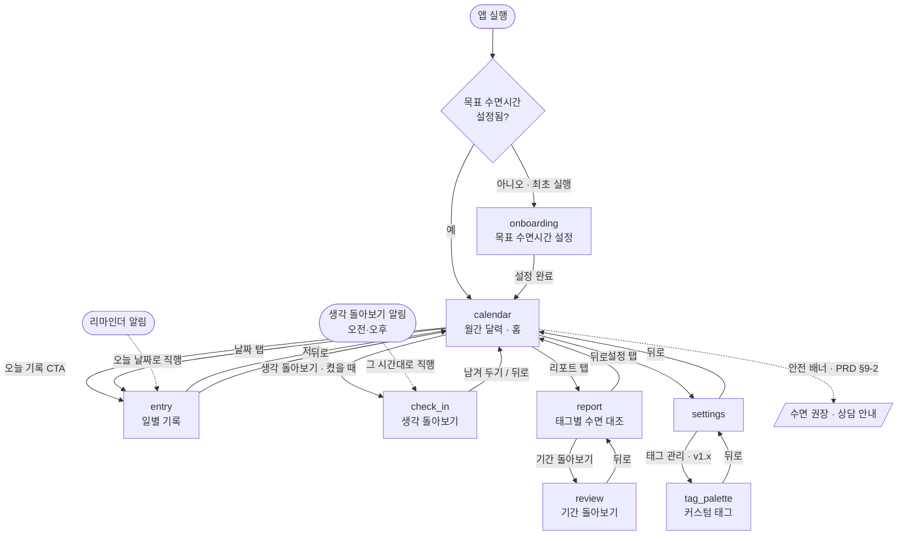

# 화면 흐름도 — sleep_log (슬립로그)

- **대상 앱**: `apps/sleep_log`
- **기준 PRD**: `docs/prd/sleep_log.md`
- **문서 상태**: 초안 (2026-09-27)

---

## 1. 화면 목록

화면 ID는 go_router의 `name`과 1:1로 대응시킨다.

| 화면 ID | 이름 | 목적 (1문장) | 진입 조건 |
|---------|------|--------------|-----------|
| `onboarding` | 목표 수면시간 설정 | 개인 목표 수면시간을 정한다 — 이 값이 없으면 z 표시가 성립하지 않는다 | 최초 실행, 목표값 미설정 시 |
| `calendar` | 달력 (홈) | 월간 z 표시로 수면 패턴을 한눈에 본다 | 기본 진입 화면 |
| `entry` | 일별 기록 | 하루의 취침·기상 시각과 감정 태그를 넣고 고친다 | 달력에서 날짜 선택, 또는 리마인더 알림 |
| `report` | 리포트 | 태그별 평균 수면시간을 대조해 패턴을 확인한다 | 달력에서 진입 |
| `settings` | 설정 | 목표 수면시간, 알림, 안전 안내 on/off | 달력에서 진입 |
| `check_in` | 생각 돌아보기 | 오전·오후에 머릿속 속도·감각·생각을 스스로 살펴본다 (PRD §3-3, 선택 기능) | 달력의 버튼(기능을 켰을 때), 또는 생각 돌아보기 알림 |
| `review` | 기간 돌아보기 | 고른 기간의 이어진 흐름·생각들·편지를 본다 (PRD §3-4) | 리포트에서 진입 |
| `tag_palette` | 태그 팔레트 관리 | 커스텀 태그를 만들고 정리한다 (**v1.x**) | 설정에서 진입 |

화면 8개 중 `tag_palette`는 v1 범위 밖이다(PRD §3-2). v1은 7개.

## 2. 전체 흐름도

**작성 규칙 적용 메모**

- 안전 배너는 화면이 아니라 `calendar` 안의 요소이므로 점선으로만 표기했다.
- `onboarding`은 최초 1회만 지나가며, 이후 목표값 변경은 `settings`에서 한다.

## 3. (게임 앱 전용) 인게임 상태 다이어그램

해당 없음 — 게임이 아니다 (PRD §9).

## 4. 딥링크 / 진입점

| 진입점 | 도착 화면 | 비고 |
|--------|-----------|------|
| 앱 아이콘 | `calendar` (최초 실행은 `onboarding`) | |
| 기록 리마인더 로컬 알림 | `entry` — **오늘 날짜로 직행** | 알림을 탭했으면 기록할 의사가 있는 것이다. 달력을 거치게 하면 마찰만 늘어난다 |
| 생각 돌아보기 로컬 알림 (오전·오후) | `check_in` — **오늘 날짜, 그 시간대로 직행** | 같은 이유. 기능을 켠 사람에게만 온다 |
| 푸시 알림 | 없음 | 서버가 없다 (PRD §9) |

## 5. 화면별 메모

흐름도로 표현되지 않는 것만 적는다.

### `calendar` (홈)

- **오늘 기록이 없으면 상단에 눈에 띄는 "오늘 기록" CTA를 띄운다.** 이 앱의
  하루 1회 핵심 행동이므로, 달력에서 오늘 칸을 찾아 누르게 하지 않는다.
- 월 좌우 스와이프로 이동. 오늘로 돌아오는 버튼을 둔다.
- 날짜 칸 표시: `z`·`zZ`·`zzZ`·`zzZZ` / **기록 없음은 빈칸(옅은 점)** — 수면 부족과
  시각적으로 구분해야 한다 (PRD §4).
- 안전 배너(PRD §9-2)가 뜨는 유일한 위치. 닫을 수 있고, 차단하지 않는다.
- 상태 유지: 마지막으로 보던 월을 기억하지 않고 **항상 이번 달로 진입**한다.
  일상 사용에서 보고 싶은 것은 늘 이번 달이다.

### `entry` (일별 기록)

- **미래 날짜는 기록할 수 없다.** 달력에서 선택 자체를 막는다.
- 취침·기상 시각은 **자정 넘김이 기본 상황**이다 (23:30 → 07:00). 날짜 경계를
  사용자에게 묻지 말고 "취침은 전날, 기상은 당일"로 해석한다.
- 수면시간은 입력 즉시 계산해 보여주고, **그 자리에서 z 단계도 같이** 보여준다.
  저장 후 달력에서 확인하게 만들지 않는다.
- 감정 태그는 복수 선택이고 **0개로도 저장된다** — 수면만 기록하는 날을 허용한다.
  반대로 수면 없이 태그만 저장하는 것도 허용한다. 둘 중 하나라도 있으면 기록이다.
- 최근 사용 태그를 앞에 배치한다 (PRD §3-1).
- 이미 기록된 날에 다시 들어오면 **편집 모드**로 열린다. 삭제도 여기서 한다.
- 저장하지 않고 뒤로 가면 변경 내용을 버릴지 확인한다.

### `report`

- **2주 미만은 리포트를 보여주지 않고 "며칠 더 기록하면 보여요"로 안내한다.**
  표본이 적을 때 나오는 상관은 틀리고, 틀린 인상을 한 번 주면 신뢰를 잃는다.
- 표시는 대조만 한다 — "짜증 태그를 붙인 날 평균 5.2시간 / 평온한 날 7.1시간".
  인과나 진단으로 읽히는 문장을 쓰지 않는다 (PRD §9-2).

### `check_in` (생각 돌아보기)

- **묻지 않고 권한다.** 증상을 확인하는 문장("환청이 있었나요")이 아니라 돌아보게
  하는 제안으로 쓴다. 모든 질문을 건너뛸 수 있다.
- 질문: 머릿속 속도(느긋/평소/바쁘게) · 소리·빛·몸의 느낌이 평소와 달랐던 순간
  (없음/한두 번/여러 번) · 마음을 차지한 생각 한 줄 → 적었을 때만 "친한 친구가
  같은 말을 한다면 어떤 말을 건네줄까" (확증편향을 지적하지 않고 다른 가능성을
  스스로 떠올리게 한다).
- 답에 즉시 반응하지 않는다 — 칭찬도 경고도 없이 저장만 한다.
- 오전/오후는 여는 시각으로 정한다(14시 기준). 알림으로 열면 알림의 시간대.

### `review` (기간 돌아보기)

- 기간: 최근 7/14/30일 칩 + "직접 고르기"(기간 선택기, 첫 기록 ~ 오늘). 기본 14일.
- 흐름은 같은 구간끼리 한 줄로 묶고 최근 구간부터. 좋은 흐름은 해, 힘든 흐름은 구름
  아이콘 — 경고색은 쓰지 않는다.
- 생각 카드는 섞어서 최대 5개, "다시 섞기". 편지는 열 때 한 번 고르고 기간을 바꿔도
  그대로 둔다(자꾸 바뀌면 산만하다).

### `settings`

- 목표 수면시간 변경 시, **과거 z 표시가 전부 재계산된다는 것을 알린다.**
  저장된 것은 수면시간이고 z는 목표 대비 판정이므로, 목표를 바꾸면 지난 달력이
  달라 보인다. 사전 안내 없이 달력이 바뀌면 버그로 보인다.
- 안전 안내 on/off (기본 켜짐), 리마인더 알림 시각 설정.
- 데이터 내보내기·삭제 경로를 여기 둔다. 건강 데이터이므로 **전체 삭제 수단을
  반드시 제공한다** (PRD §9-1).

### 뒤로가기 (Android)

- `calendar`에서 뒤로 = 앱 종료. 확인 다이얼로그를 띄우지 않는다.
- `onboarding`에서 뒤로 = 앱 종료. 목표값 없이 `calendar`로 보낼 수 없다.
